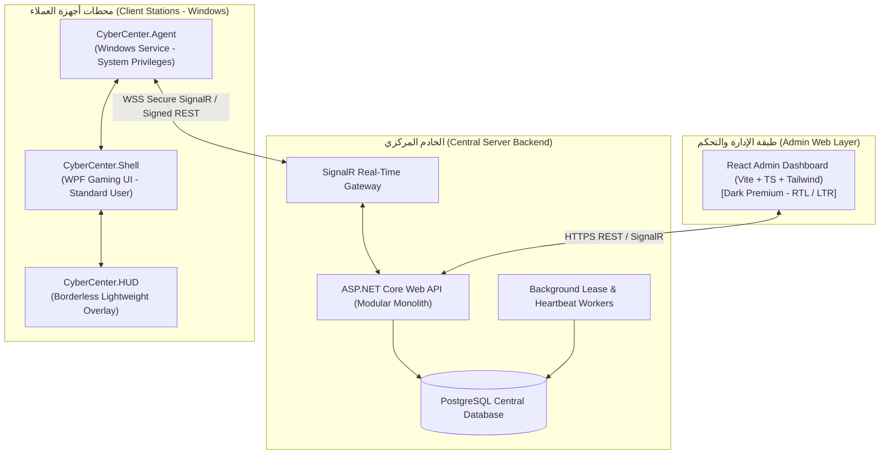

# CyberCenter ⚡

> **نظام مركزي متكامل لإدارة مراكز الإنترنت وصالات الألعاب الاحترافية**  
> *Production-Ready, Centralized Internet Café & Gaming Center Management Platform*

[-brightgreen.svg)](#)
[-success.svg)](#)
[](#)
[](#)

---

## 📖 نظرة عامة (Overview)

**CyberCenter** هو حل برمجي هندسي شامل ومصمم لتلبية أعلى معايير الاستقرار والأمان في إدارة صالات الألعاب التنافسية (eSports Lounges) ومراكز الإنترنت (Internet Cafés). يوفر النظام تحكماً مركزياً عالي الدقة في محطات العمل (Windows Client Stations) عبر خادم خلفي فائق السرعة، مع لوحة تحكم إدارية ومحاسبية تفاعلية (Dark Premium Web Dashboard) وتطبيق عميل متطور يعمل بتناغم لمنع التلاعب وتوفير تجربة مستخدم استثنائية للاعبين والزوار.

---

## 🏗️ البنية الهندسية للنظام (Architecture Components)

يتكون المشروع من ثلاثة أنظمة مترابطة عبر بروتوكولات آمنة وموثقة:



1. **Web Admin Dashboard (`CyberCenter.Dashboard`):**
   - واجهة إدارية حديثة مبنية بـ React 18 و TypeScript و Tailwind CSS.
   - هوية Dark Premium تدعم اللغتين العربية (افتراضياً بتقنية RTL كاملة) والإنجليزية.
   - شاشات مراقبة الأجهزة الحية، إدارة الحسابات، الكروت المؤقتة، نقاط البيع والمتجر، المحاسبة الدقيقة وإقفال الفترات المالية، مراقبة استهلاك الإنترنت وتكلفة الطاقة.

2. **Central Backend Server (`CyberCenter.Server`):**
   - مبني وفق مبادئ **Clean Architecture** و **Modular Monolith** على منصة **ASP.NET Core 8 LTS**.
   - اتصال فوري ثنائي الاتجاه عبر **SignalR WebSockets** مع خوارزميات Session Lease للتعامل مع انقطاع الشبكة دون فقدان الوقت.
   - قاعدة بيانات **PostgreSQL** موثوقة مع عمليات مالية محصورة في Database Transactions غير قابلة للتلاعب وسجل تدقيق شامل (Audit Log).

3. **Windows Client Suite (`CyberCenter.Client`):**
   - **`CyberCenter.Agent`**: خدمة نظام مستقلة (Windows Worker Service) تدير أمان المحطة، تنفيذ الأوامر الموقعة (Signed Commands)، إرسال الـ Heartbeat ومراقبة سلامة الجلسة بدون منح المستخدم صلاحيات مدير.
   - **`CyberCenter.Shell`**: واجهة المستخدم الرئيسية (WPF / XAML) لتسجيل الدخول، استعراض مكتبة الألعاب والطلبات.
   - **`CyberCenter.HUD`**: شريط علوي خفيف غير تدخلي يعرض الوقت المتبقي، سرعة الإنترنت والاستهلاك، دون حقن أكواد (No DLL Injection) متوافق تماماً مع أنظمة مكافحة الغش (Anti-Cheat).

---

## 📁 هيكل المجلدات (Repository Structure)

```text
CyberCenter/
├── src/
│   ├── Server/
│   │   ├── CyberCenter.API/            # نقطة الدخول، Controllers، Hubs، Middleware
│   │   ├── CyberCenter.Application/    # حالات الاستخدام، CQRS/Services، DTOs، Validators
│   │   ├── CyberCenter.Domain/         # الكيانات (Entities)، التعدادات (Enums)، قواعد الأعمال
│   │   ├── CyberCenter.Infrastructure/ # EF Core، PostgreSQL DbContext، Repositories، Security
│   │   └── CyberCenter.Workers/        # Background Services، Session Leases، Heartbeat Monitor
│   │
│   ├── Client/
│   │   ├── CyberCenter.Agent/          # Windows Service لضبط الأمان والتواصل المركزي
│   │   ├── CyberCenter.Shell/          # واجهة سطح المكتب الحديثة للألعاب والجلسات
│   │   └── CyberCenter.HUD/            # شريط التراكب الشفاف للوقت والشبكة
│   │
│   ├── Admin/
│   │   └── CyberCenter.Dashboard/      # لوحة الإدارة (React, Vite, TypeScript, Tailwind)
│   │
│   └── Shared/
│       └── CyberCenter.Contracts/      # العقود المشتركة، DTOs، Enums الموحدة
│
├── tests/
│   ├── CyberCenter.UnitTests/          # اختبارات الوحدة للمنطق المحاسبي والجلسات
│   ├── CyberCenter.IntegrationTests/   # اختبارات تكامل الـ API وقاعدة البيانات
│   └── CyberCenter.ClientTests/        # اختبارات خدمة العميل والـ IPC
│
├── deployment/
│   ├── server/                         # إعدادات النشر، Docker Compose، Systemd/IIS
│   ├── client/                         # حزم تثبيت العميل ومثبتات الـ Windows Service
│   ├── windows-policies/               # سياسات Shell Launcher، WDAC، GPO لتأمين المحطات
│   └── scripts/                        # سكربتات النسخ الاحتياطي والأتمتة
│
├── docs/                               # التوثيق المعماري والتقني الشامل
├── .gitignore
└── README.md
```

---

## 🛡️ المبادئ الأمنية الصارمة (Security Principles)

- **Defense-in-Depth (الدفاع متعدد الطبقات):** فصل واجهة المستخدم عن خدمة النظام، تشغيل المستخدمين بحسابات قياسية (Standard User) دون صلاحيات Administrator.
- **Signed Commands & Allowlist:** منع تنفيذ أوامر النظام العشوائية؛ جميع أوامر الخادم للجهاز موثقة ومشفرة ومحددة بقائمة بيضاء مسبقة.
- **Anti-Cheat Safe:** عدم استخدام تقنيات الحقن (DLL Injection) أو التعديل على ذاكرة الألعاب حتى لا تتعرض حسابات الزوار للحظر في ألعاب eSports.
- **Financial Auditability:** القيود المالية غير قابلة للحذف، ويتم تسجيل كافة العمليات الإدارية في جدول `AuditLogs` غير القابل للتعديل مع قيود Foreign Key و Transactions.
- **No Secrets in Repo:** حظر إدراج كلمات السر، الـ Connection Strings، أو مفاتيح التشفير داخل الشيفرة البرمجية والاعتماد على بيئة التشغيل المشفرة و Secrets Store.

---

## 📚 التوثيق الهندسي وتشغيل النظام (Project Documentation)

تم توثيق النظام بمعايير Enterprise متقدمة في مجلد `docs/`:
- [دليل تشغيل النظام الشامل للمشغلين والمدراء (Operator & User Manual)](file:///docs/OPERATOR_MANUAL.md)
- [تقرير نتائج الجودة والاختبارات الشاملة (QA Test Run Report)](file:///docs/QA_TEST_RUN_REPORT.md)
- [نظرة عامة على المشروع (Project Overview)](file:///docs/PROJECT_OVERVIEW.md)
- [المتطلبات الوظيفية والتقنية (Requirements)](file:///docs/REQUIREMENTS.md)
- [معمارية النظام والاتصالات (System Architecture)](file:///docs/SYSTEM_ARCHITECTURE.md)
- [تصميم قاعدة البيانات (Database Design)](file:///docs/DATABASE_DESIGN.md)
- [الخطة الأمنية وسياسات ويندوز (Security Plan)](file:///docs/SECURITY_PLAN.md)
- [خارطة الطريق ومراحل التنفيذ (Implementation Roadmap)](file:///docs/IMPLEMENTATION_ROADMAP.md)
- [دليل تجربة وواجهة المستخدم (UI/UX Guidelines)](file:///docs/UI_UX_GUIDELINES.md)
- [استراتيجية الاختبار وضمان الجودة (Testing Strategy)](file:///docs/TESTING_STRATEGY.md)
- [سجل القرارات المعمارية (Decisions Log / ADRs)](file:///docs/DECISIONS.md)

---

## 🚀 البدء السريع وتشغيل النظام (Quick Start & Running)

### 1. تشغيل جناح الاختبارات الآلية الشامل (Automated Tests):
```bash
# تشغيل حزمة اختبارات .NET الشاملة (52 اختباراً):
dotnet run --project tests/CyberCenter.UnitTests/CyberCenter.UnitTests.csproj

# تشغيل اختبارات تكامل النسخ الاحتياطي واكتشاف التلاعب (Tamper Detection):
powershell -ExecutionPolicy Bypass -File deployment/scripts/Test-BackupRestoreIntegrity.ps1
```

### 2. تشغيل الخادم المركزي (Central Backend Server):
```bash
dotnet run --project src/Server/CyberCenter.API/CyberCenter.API.csproj
# يستمع الخادم على: http://localhost:5000 (Swagger: http://localhost:5000/swagger)
```

### 3. تشغيل لوحة الإدارة (Web Admin Dashboard):
```bash
cd src/Admin/CyberCenter.Dashboard
npm install
npm run dev
# تعمل اللوحة على: http://localhost:5173
```

### 4. تثبيت محطة العميل وتطبيق سياسات الأمان (Client Station Installation):
```powershell
# تشغيل موجه أوامر PowerShell كمسؤول (Run as Administrator):
cd deployment\client
.\Install-CyberCenterStation.ps1 -ServerUrl "http://192.168.1.100:5000" -StationNumber 1 -AutoLogon $true
```

### 5. النسخ الاحتياطي والاستعادة الآمنة المشفرة (Backup & Disaster Recovery):
```powershell
# أخذ نسخة احتياطية فورية مع توثيق بصمة SHA-256:
.\deployment\scripts\Backup-CyberCenterDatabase.ps1 -BackupDir "C:\CyberCenter\Backups"

# استعادة وفحص السلامة الرقمية قبل التطبيق:
.\deployment\scripts\Restore-CyberCenterDatabase.ps1 -BackupFilePath "C:\CyberCenter\Backups\cybercenter_backup_YYYYMMDD_HHMMSS.sql"
```

