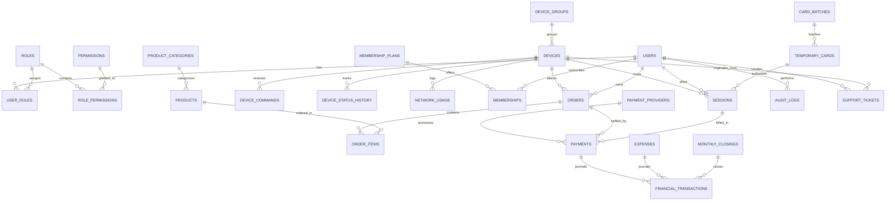

# وثيقة تصميم قاعدة البيانات (Database Design Document)
## مخطط قاعدة بيانات PostgreSQL لنظام CyberCenter

---

## 1. المعايير الهندسية لقاعدة البيانات (Data Modeling Standards)

- **المحرك:** PostgreSQL 15+ مع تفعيل الامتدادات الأساسية (`uuid-ossp`, `pgcrypto`).
- **المعرفات (Primary Keys):** استخدام `UUID v4` لجميع الجداول الحساسة والقابلة للتزامن لمنع التخمين وحماية خصوصية المعرفات التسلسلية في الـ API.
- **التواريخ والأوقات (Timestamps):** تخزين جميع التواريخ بنوع `TIMESTAMPTZ` بتوقيت جرينتش الموحد (`UTC`). يتم التحويل لتوقيت المركز المحلي فقط في طبقة العرض (UI Layer).
- **القيم المالية (Financial Accuracy):** استخدام `DECIMAL(18,2)` (أو `NUMERIC(18,2)`) لكافة الحقول المالية (الأسعار، الأرصدة، الإيرادات، المصروفات). يُحظر حظراً تاماً استخدام أنواع الفواصل العائمة (`FLOAT` / `DOUBLE`) تجنباً لأخطاء التقريب المالي.
- **النزاهة المرجعية (Referential Integrity):** فرض قيود المفاتيح الأجنبية (`FOREIGN KEY`)، قيود الفحص (`CHECK Constraints`)، والمؤشرات الفريدة (`UNIQUE Constraints`).
- **الحذف المنطقي والتاريخي (Soft Delete vs Audit Log):** تطبيق الحذف المنطقي (`is_deleted`, `deleted_at_utc`) فقط على الكيانات القابلة للاسترجاع (مثل المنتجات، الأجهزة، خطط الاشتراكات)، بينما السجلات المالية والـ `audit_logs` و `sessions` و `payments` هي سجلات أبدية غير قابلة للحذف نهائياً (Append-Only / Immutable).

---

## 2. المخطط العلائقي (Entity-Relationship Diagram)

---

## 3. تفاصيل الجداول والحقول (Detailed Data Dictionary)

### 3.1. الأمان والمستخدمين (Security & Identity)

#### جدول `users`
| الحقل | النوع | القيود | الوصف |
| :--- | :--- | :--- | :--- |
| `id` | UUID | PK, NOT NULL | المعرف الفريد |
| `username` | VARCHAR(50) | UNIQUE, NOT NULL | اسم المستخدم لتسجيل الدخول |
| `email` | VARCHAR(100) | NULL | البريد الإلكتروني |
| `phone_number` | VARCHAR(25) | NULL | رقم الهاتف للتواصل والتحقق |
| `password_hash` | VARCHAR(255) | NOT NULL | هاش كلمة المرور (BCrypt / Argon2) |
| `full_name` | VARCHAR(100) | NOT NULL | الاسم الكامل |
| `user_type` | VARCHAR(20) | NOT NULL | `SuperAdmin`, `Admin`, `Member`, `Staff` |
| `wallet_balance`| DECIMAL(18,2)| NOT NULL, DEFAULT 0 | الرصيد المالي في المحفظة |
| `remaining_seconds`| INT | NOT NULL, DEFAULT 0 | الرصيد الزمني المتراكم بالثواني |
| `is_active` | BOOLEAN | NOT NULL, DEFAULT TRUE | حالة تنشيط الحساب |
| `created_at_utc`| TIMESTAMPTZ | NOT NULL | تاريخ الإنشاء |
| `updated_at_utc`| TIMESTAMPTZ | NULL | تاريخ آخر تحديث |

#### جدول `roles` & `permissions` & `user_roles`
- تنظيم صلاحيات مبني على الأدوار (RBAC) يمنح مرونة تامة في تحديد وصول كل موظف.

---

### 3.2. إدارة الأجهزة (Device Fleet Management)

#### جدول `device_groups`
- تحديد مناطق المركز: `VIP Lounge`, `Main Hall`, `Console Zone`, `Streamer Booth` مع تحديد سعر الساعة الافتراضي لكل منطقة.

#### جدول `devices`
| الحقل | النوع | القيود | الوصف |
| :--- | :--- | :--- | :--- |
| `id` | UUID | PK, NOT NULL | المعرف الفريد |
| `device_number` | INT | UNIQUE, NOT NULL | رقم المحطة الفيزيائي المعروض للزبائن |
| `device_name` | VARCHAR(100) | NOT NULL | اسم الحاسوب في الشبكة (Hostname) |
| `group_id` | UUID | FK -> `device_groups.id` | مجموعة المنطقة التابع لها |
| `mac_address` | VARCHAR(17) | NOT NULL | العنوان الفيزيائي لبطاقة الشبكة |
| `ip_address` | VARCHAR(45) | NOT NULL | عنوان IP الحالي |
| `status` | VARCHAR(20) | NOT NULL | `Available`, `Occupied`, `Reserved`, `Maintenance`, `Offline`, `Locked`, `Error` |
| `hourly_rate` | DECIMAL(18,2)| NULL | تسعيرة مخصصة للجهاز (إن وُجدت) |
| `hardware_specs`| JSONB | NULL | معالج، كرت شاشة، رام، سعة تخزين |
| `agent_version` | VARCHAR(20) | NULL | إصدار عميل الخدمة المثبت |
| `last_heartbeat_utc`| TIMESTAMPTZ| NULL | آخر وقت نبض وصل للخادم |
| `created_at_utc`| TIMESTAMPTZ | NOT NULL | تاريخ الإضافة |

#### جدول `device_commands`
- طابور الأوامر المرسلة للجهاز عن بُعد (`Lock`, `Unlock`, `Reboot`, `Shutdown`, `Message`, `ExtendLease`) مع تسجيل المعرف الفريد `idempotency_key`، وحالة التنفيذ (`Pending`, `Executed`, `Failed`) ورمز خطأ التنفيذ.

---

### 3.3. إدارة الكروت المؤقتة والجلسات (Cards & Sessions)

#### جدول `card_batches`
- تتبع مجموعات الكروت المولدة بالجملة: اسم الدفعة، مدة الكرت بالدقائق، السعر، عدد الكروت، المشرف الذي ولدها، تاريخ الانتهاء.

#### جدول `temporary_cards`
| الحقل | النوع | القيود | الوصف |
| :--- | :--- | :--- | :--- |
| `id` | UUID | PK, NOT NULL | المعرف الفريد للكرت |
| `batch_id` | UUID | FK -> `card_batches.id` | الدفعة المولدة |
| `card_code_masked`| VARCHAR(20) | NOT NULL | كود العرض المشوش (مثل `CC-****-****-8921`) |
| `pin_hash` | VARCHAR(255) | NOT NULL | الهاش الآمن للـ PIN السري المكون من 16 رقماً |
| `total_duration_seconds`| INT | NOT NULL | إجمالي المدة الزمنية الممنوحة |
| `remaining_seconds`| INT | NOT NULL | الثواني المتبقية الصالحة للاستخدام |
| `status` | VARCHAR(20) | NOT NULL | `Unused`, `Active`, `Depleted`, `Expired`, `Revoked` |
| `expires_at_utc`| TIMESTAMPTZ| NOT NULL | تاريخ انتهاء صلاحية الكرت |
| `first_used_at_utc`| TIMESTAMPTZ| NULL | وقت أول استخدام |

#### جدول `sessions`
| الحقل | النوع | القيود | الوصف |
| :--- | :--- | :--- | :--- |
| `id` | UUID | PK, NOT NULL | معرف الجلسة |
| `device_id` | UUID | FK -> `devices.id` | الجهاز المستضاف |
| `user_id` | UUID | FK -> `users.id`, NULL | العضو المسجل (إن وُجد) |
| `temporary_card_id`| UUID | FK -> `temporary_cards.id`, NULL | الكرت المؤقت (إن وُجد) |
| `session_type` | VARCHAR(20) | NOT NULL | `Open`, `TemporaryCard`, `MemberPrepaid`, `MemberSubscription` |
| `started_at_utc`| TIMESTAMPTZ | NOT NULL | توقيت البداية |
| `ended_at_utc` | TIMESTAMPTZ | NULL | توقيت النهاية الفعلي |
| `allocated_seconds`| INT | NOT NULL | الثواني المخصصة للجلسة (أو 0 للمفتوحة) |
| `consumed_seconds` | INT | NOT NULL, DEFAULT 0 | الثواني المستهلكة فعلياً |
| `total_cost` | DECIMAL(18,2)| NOT NULL, DEFAULT 0 | التكلفة المالية الإجمالية للجلسة |
| `status` | VARCHAR(20) | NOT NULL | `Active`, `Paused`, `Completed`, `TerminatedByAdmin`, `TerminatedTimeout` |
| `end_reason` | VARCHAR(100) | NULL | سبب الإغلاق |

---

### 3.4. المتجر الداخلي ونقاط البيع (Store & POS)

#### جداول `product_categories` & `products`
- المنتجات، التصنيفات، الأسعار، التكلفة، المخزون المتوفر، الصورة، والأزرار المتاحة للطلب من أجهزة العملاء.

#### جدول `orders` & `order_items`
- تسجيل الطلبات القادمة من شاشات الأجهزة مع تتبع فوري للحالات:
  `New`, `AwaitingPayment`, `Paid`, `Preparing`, `Ready`, `Delivered`, `Cancelled`.

---

### 3.5. المحاسبة والماليات والإقفال (Accounting & Finance)

#### جدول `payments`
- سجل حركات الدفع المرتبطة بالجلسات أو طلبات المتجر أو شحن أرصدة الأعضاء مع طريقة الدفع: `Cash`, `Wallet`, `ManualTransfer`, `ElectronicGateway`.

#### جدول `financial_transactions` (دفتر الأستاذ غير القابل للتعديل - General Ledger)
| الحقل | النوع | القيود | الوصف |
| :--- | :--- | :--- | :--- |
| `id` | UUID | PK, NOT NULL | معرف القيد المالي |
| `transaction_number`| VARCHAR(30) | UNIQUE, NOT NULL | رقم مرجعي تسلسلي محاسبي |
| `transaction_type` | VARCHAR(30) | NOT NULL | `SessionRevenue`, `StoreRevenue`, `MembershipDeposit`, `Expense`, `Reversal` |
| `amount` | DECIMAL(18,2)| NOT NULL | القيمة المالية |
| `created_by_user_id`| UUID | FK -> `users.id` | الموظف الذي أجرى القيد |
| `payment_id` | UUID | FK -> `payments.id`, NULL | الدفعة المرتبطة |
| `expense_id` | UUID | FK -> `expenses.id`, NULL | المصروف المرتبط |
| `description` | TEXT | NOT NULL | بيان القيد وتفاصيل العملية |
| `is_reversed` | BOOLEAN | NOT NULL, DEFAULT FALSE | هل تم عكس هذا القيد بقيد تسوية لاحق؟ |
| `reversal_ref_id` | UUID | NULL | مرجع قيد العكس في حال التصحيح |
| `created_at_utc` | TIMESTAMPTZ | NOT NULL | وقت وتاريخ القيد |

#### جدول `monthly_closings`
- سجل الإقفال الشهري المعتمد من قبل الـ Super Admin: إجمالي الإيرادات، المصروفات، صافي الأرباح، الرصيد المرحل، وتوقيع الاعتماد الرقمي.

---

### 3.6. سجل التدقيق والشبكة والطاقة (Audit, Network, Energy)

#### جدول `audit_logs`
- جدول تدقيق شامل محمي برمجياً من الحذف والتعديل (`Append-Only`) يسجل:
  `id`, `user_id`, `action_name`, `entity_name`, `entity_id`, `before_state_json`, `after_state_json`, `ip_address`, `user_agent`, `created_at_utc`.

#### جدول `network_usage`
- قراءات استهلاك النبض لكل جهاز: `download_bytes`, `upload_bytes`, `current_down_bps`, `current_up_bps`.

#### جدول `energy_readings`
- تسجيل قراءات الطاقة: استهلاك مقاس بالعداد الذكي (`measured_kwh`) مقابل الاستهلاك الحسابي التقديري (`estimated_kwh`).

