# وثيقة خارطة طريق التنفيذ (Implementation Roadmap)
## مراحل بناء واختبار نظام CyberCenter

---

## 1. استراتيجية التنفيذ المرحلية (Phased Execution Strategy)

لضمان جودة هندسية فائقة ومنع تراكم الأخطاء، يتم بناء نظام **CyberCenter** عبر 11 مرحلة متعاقبة (من المرحلة 0 إلى المرحلة 10).  
**قاعدة ذهبية:** لا يتم الانتقال من مرحلة إلى أخرى إلا بعد نجاح البناء (Build Pass)، اجتياز جميع اختبارات المرحلة، وتحقيق كافة معايير القبول المحددة، مع توثيق تقرير إنجاز متكامل وإنشاء Git Commit واضح.

---

## 2. المراحل والمخرجات ومعايير القبول (Phases Breakdown)

```mermaid
flowchart LR
    P0["Phase 0\nDiscovery & Docs"] --> P1["Phase 1\nFoundation & Scaffolding"]
    P1 --> P2["Phase 2\nAuth & Admin RBAC"]
    P2 --> P3["Phase 3\nDevices & Agent Service"]
    P3 --> P4["Phase 4\nSession Lifecycle & Cards"]
    P4 --> P5["Phase 5\nClient Shell & HUD"]
    P5 --> P6["Phase 6\nStore & Kitchen KDS"]
    P6 --> P7["Phase 7\nAccounting & Monthly Close"]
    P7 --> P8["Phase 8\nNetwork & Energy Monitor"]
    P8 --> P9["Phase 9\nHardening & Deployment"]
    P9 --> P10["Phase 10\nFinal QA & Operations"]
```

---

### Phase 0 — التحليل والمعمارية وهندسة الوثائق (Discovery & Architecture)
- **الأهداف:** فحص بيئة العمل، تحليل المتطلبات، اختيار أحدث الإصدارات، إنشاء التصميم المعماري الشامل وقاعدة البيانات والخطة الأمنية.
- **المخرجات:**
  - `README.md`
  - `docs/PROJECT_OVERVIEW.md`
  - `docs/REQUIREMENTS.md`
  - `docs/SYSTEM_ARCHITECTURE.md`
  - `docs/DATABASE_DESIGN.md`
  - `docs/SECURITY_PLAN.md`
  - `docs/IMPLEMENTATION_ROADMAP.md`
  - `docs/UI_UX_GUIDELINES.md`
  - `docs/TESTING_STRATEGY.md`
  - `docs/DECISIONS.md`
- **معايير القبول (Acceptance Gate):** مراجعة جميع وثائق المعمارية بدقة والتحقق من تغطية كافة المتطلبات التقنية والتشغيلية.

---

### Phase 1 — التأسيس والبنية التحتية المشتركة (Foundation & Core Infrastructure)
- **الأهداف:** إنشاء هيكل المشروع الكامل (Solution Scaffolding)، إعداد الخادم الخلفي (ASP.NET Core Web API + EF Core + PostgreSQL)، إعداد لوحة الإدارة React + Vite + TypeScript بنظام تصميم Dark Premium، تهيئة نظام التدويل (i18n العربي والإنجليزي)، وإنشاء مستودع Git والتهيئة الأساسية.
- **المخرجات:**
  - مشاريع `src/Server/`, `src/Client/`, `src/Admin/`, `src/Shared/`.
  - تطبيق الويب React يعمل مع Vite وتكامل Tailwind CSS ودعم RTL/LTR.
  - تكوين قاعدة بيانات PostgreSQL مع DbContext و Entity Configurations.
  - إعداد مستودع Git بـ `.gitignore` احترافي وحظر رفع الأسرار.
- **معايير القبول:** تجميع المشروع بنجاح دون أي خطأ، تشغيل الواجهة وظهور التصميم الأساسي، واتصال الخادم بقاعدة البيانات بنجاح.

---

### Phase 2 — المصادقة وإدارة المستخدمين والصلاحيات (Authentication & RBAC)
- **الأهداف:** بناء خدمات الهوية والمصادقة الآمنة، تشفير كلمات المرور بـ BCrypt، إصدار وتجديد رموز JWT، تنفيذ نظام الصلاحيات المبني على الأدوار (SuperAdmin vs Admin/Cashier)، بناء شاشات تسجيل الدخول، إدارة الموظفين، سجل التدقيق (Audit Logs)، وإعدادات المركز.
- **المخرجات:**
  - `AuthService`, `JwtTokenGenerator`, `PasswordHasher`.
  - شاشات: تسجيل الدخول، لوحة الإحصائيات العامة، إدارة الموظفين، شاشة سجل العمليات (Audit Trail)، شاشة إعدادات النظام.
  - حماية مسارات API عبر السياسات (`[Authorize(Roles = ...)]`).
- **معايير القبول:** نجاح اختبارات المصادقة، عدم السماح للمشرف العادي بالوصول لوظائف Super Admin، وتسجيل جميع الحركات في جدول الـ Audit Logs.

---

### Phase 3 — إدارة الأجهزة ونبض العميل الآمن (Devices & Agent Heartbeat)
- **الأهداف:** تسجيل محطات العمل واكتشافها، بناء قناة SignalR Hub الحية للأجهزة، برمجة خدمة `CyberCenter.Agent` كـ Windows Worker Service، تنفيذ تبادل النبض الدوري (Heartbeat) وتحديث الحالات لحظياً، وإرسال الأوامر الموقعة المعتمدة.
- **المخرجات:**
  - `DeviceHub` في الخادم الخلفي.
  - خدمة `CyberCenter.Agent` (Windows Service) في العميل.
  - شاشة الأجهزة الحية (Live Devices Grid & Table View) مع بطاقات غنية بالمعلومات وقائمة إجراءات سريعة.
- **معايير القبول:** تحديث حالة الأجهزة على الشاشة فورياً عبر SignalR عند تشغيل أو إيقاف الـ Agent، وقفل/فتح المحطة بناءً على الأوامر الصادرة من اللوحة.

---

### Phase 4 — إدارة الجلسات والكروت المؤقتة والأعضاء (Sessions & Timing Engine) [مكتملة بنجاح ✔]
- **الأهداف:** محرك الجلسات المركزي، دعم الجلسات المفتوحة (Open Sessions)، نظام توليد وتشفير وطباعة الكروت المؤقتة (Temporary Cards) وتصديرها CSV/Excel، إدارة حسابات واشتراكات الأعضاء (Members & Plans)، وخوارزمية عقود الإيجار الموقعة رقمياً (Session Leases).
- **المخرجات:**
  - وحدات API: `SessionsController`, `TemporaryCardsController`, `MembersController`.
  - عقود DTOs المكتملة والموثقة: `SessionDtos.cs`.
  - شاشات Dashboard التفاعلية الفاخرة Dark Premium:
    - شاشة `SessionsPage`: استعراض ومتابعة الجلسات المفتوحة والمؤقتة وعضويات المشتركين لحظياً، تمديد الوقت، وإنهاء الجلسات مع احتساب التكاليف.
    - شاشة `TemporaryCardsPage`: توليد دفعات الكروت المؤقتة برموز 16 رقماً مشفرة PBKDF2، طباعة الكروت الفورية، وتصدير الدفعات إلى ملفات CSV.
    - شاشة `MembersPage`: دليل المشتركين الدائمين، شحن أرصدة المحافظ النقدية، إضافة باقات الساعات، وإدارة تفعيل وإيقاف الحسابات.
  - اختبارات آلية شاملة (35 اختباراً ناجحاً بنسبة 100%) تغطي بدء الجلسات وتمديدها وإنهائها، توليد الكروت والتحقق من PIN، وتصدير CSV، وشحن محافظ الأعضاء.
- **معايير القبول:** انتهاء الجلسة فور استهلاك الثواني، استحالة استخدام كرت مستهلك أو منتهي الصلاحية، ودقة توقيت الخادم بنسبة 100%. [تم التحقق منها بنجاح].

---

### Phase 5 — واجهة العميل وشريط التراكب والألعاب (Client Shell & HUD) [مكتملة بنجاح ✔]
- **الأهداف:** بناء واجهة ألعاب جذابة وفاخرة (WPF Modern Dark Gaming UI)، شاشات تسجيل الدخول بالكروت أو حسابات الأعضاء، متصفح مكتبة الألعاب السريع، شريط التراكب الشفاف الخفيف (HUD) الذي يعرض الوقت والاستهلاك دون حقن ذاكرة، والقائمة السريعة (Quick Menu / F8).
- **المخرجات:**
  - تطبيق `CyberCenter.Shell` (WPF Gaming Client):
    - شاشة القفل والترحيب الفاخرة (Lock Screen) مع منع إغلاق النافذة عبر Alt+F4.
    - إدخال كروت الدقائق وتنسيق الـ PIN التلقائي `XXXX-XXXX-XXXX-XXXX`.
    - تسجيل دخول الأعضاء الدائمين (Member Credentials).
    - لوحة الجلسة النشطة (Active Gaming Dashboard) مع العداد التنازلي التفاعلي الملون (تنبيه أصفر < 10 دقائق، أحمر < 2 دقيقة).
    - مكتبة الألعاب والتطبيقات (Game Catalog) مع تصنيفات وفلاتر وسرعة إطلاق فورية.
  - تطبيق `CyberCenter.HUD` (WPF Transparent Overlay):
    - شريط علوي خفيف وشفاف بنمط Dark Glassmorphism و Topmost دون أي حقن ذاكرة لحماية اللاعبين من حظر مكافحات الغش (Anti-Cheat Safe).
    - عرض الوقت المتبقي، سرعة الإنترنت اللحظية، ورقم المحطة، مع إمكانية السحب والتحريك (Draggable) واختصار القائمة السريعة F8.
  - بروتوكول الاتصال المحلي (Station Local IPC Contracts) في `CyberCenter.Contracts.IPC`.
  - جناح اختبارات آلية يضم 38 اختباراً ناجحاً بنسبة 100%.
- **معايير القبول:** منع الهروب من واجهة القفل، استجابة سريعة للـ Quick Menu عبر مفتاح الاختصار F8، وثبات شريط الـ HUD فوق الشاشات دون تعارض مع الألعاب. [تم التحقق منها بنجاح].

---

### Phase 6 — المتجر الداخلي والطلبات وشاشة المطبخ (Store & Kitchen KDS)
- **الأهداف:** إدارة تصنيفات ومنتجات المتجر الداخلي (مشروبات، وجبات، إكسسوارات)، واجهة سلة التسوق داخل شاشة العميل، نظام الطلبات الفورية، وشاشة المطبخ والكاشير التفاعلية (Kitchen Display System).
- **المخرجات:**
  - شاشات إدارة المنتجات والتصنيفات في لوحة الإدارة.
  - واجهة المتجر وسلة الطلبات في تطبيق العميل.
  - شاشة المطبخ KDS مع إشعارات صوتية وتحديث فوري للحالات (`New` ➔ `Preparing` ➔ `Delivered`).
- **معايير القبول:** وصول إشعار الطلب الجديد لشاشة المطبخ خلال أقل من 500 ملي ثانية، وانعكاس حالة التجهيز والتسليم لحظياً على شاشة العميل.

---

### Phase 7 — المحاسبة والماليات والإقفال الشهري (Accounting, Finance & Closing)
- **الأهداف:** محرك المدفوعات والقيود المالية المزدوجة، تسجيل إيرادات الجلسات والاشتراكات والمبيعات، تسجيل المصروفات، تقارير الأرباح والرسوم البيانية، ونظام الإقفال الشهري المعتمد برمجياً.
- **المخرجات:**
  - خدمات المحاسبة ودفتر الأستاذ غير القابل للتعديل (`financial_transactions`).
  - شاشات: المدفوعات، المصروفات، التقارير المالية والرسوم البيانية، وشاشة الإقفال الشهري المعتمد.
- **معايير القبول:** تطابق إجمالي الإيرادات والمصروفات مع الأرصدة الفعلية، وتأمين السجلات المعتمدة ضد أي تعديل أو حذف مباشر.

---

### Phase 8 — مراقبة الشبكة وتقدير تكلفة الطاقة (Network Usage & Energy Estimation)
- **الأهداف:** رصد استهلاك البيانات (Download/Upload) لكل محطة، دعم التكامل مع بوابات الشبكة (Router APIs)، تقارير أعلى المحطات استهلاكاً، ونظام حساب تكاليف الطاقة الكهربائية مع التمييز بين الاستهلاك المقاس بالعداد والاستهلاك الحسابي التقديري.
- **المخرجات:**
  - شاشات: مراقبة الشبكة الحية والتقارير البيانية، شاشة مراقبة الطاقة الكهربائية وإعدادات التعرفة.
- **معايير القبول:** دقة تتبع البيانات المرسلة والمستقبلة، ووضوح الفرق للمدير بين الاستهلاك المقاس والاستهلاك المقدر.

---

### Phase 9 — الأمان المتقدم وسياسات ويندوز والنسخ الاحتياطي (Hardening & Deployment)
- **الأهداف:** إعداد ملفات سياسات ويندوز (GPO / Registry scripts) لتعطيل مدير المهام وسطر الأوامر للعميل، سياسات Shell Launcher و WDAC، نظام النسخ الاحتياطي الآلي لقاعدة البيانات واختبار استعادتها فعلياً، وحزم التثبيت.
- **المخرجات:**
  - ملفات ومجلدات `deployment/windows-policies/`.
  - سكربتات النسخ الاحتياطي والاستعادة واختبار التحقق من سلامة الباك اب.
  - حزم ومثبتات تشغيل النظام.
- **معايير القبول:** ثبات حماية ويندوز وعدم إمكانية الهروب من بيئة العميل، واختبار استعادة قاعدة بيانات كاملة بنجاح 100%.

---

### Phase 10 — الاختبارات النهائية الشاملة ودليل التشغيل (Final QA & Handover)
- **الأهداف:** اختبار شامل للنظام (End-to-End Testing)، التحقق من اتساق التصميم في العربية RTL والإنجليزية LTR، اختبارات تحمل وانقطاع الشبكة، اختبار أداء الجلسات المتزامنة، وإعداد الدليل الشامل للمشغلين.
- **المخرجات:**
  - تقرير الجودة النهائي (QA Test Run Report).
  - دليل تشغيل النظام للمسؤولين والكاشير (User & Operations Manual).
  - اكتمال المشروع في بيئة إنتاجية جاهزة للنشر الفعلي.
- **معايير القبول:** صفر أخطاء برمجية حرجة، تماسك التصميم والأداء، واستيفاء كافة بنود التعليمات الرئيسية (Master Build Instructions).

