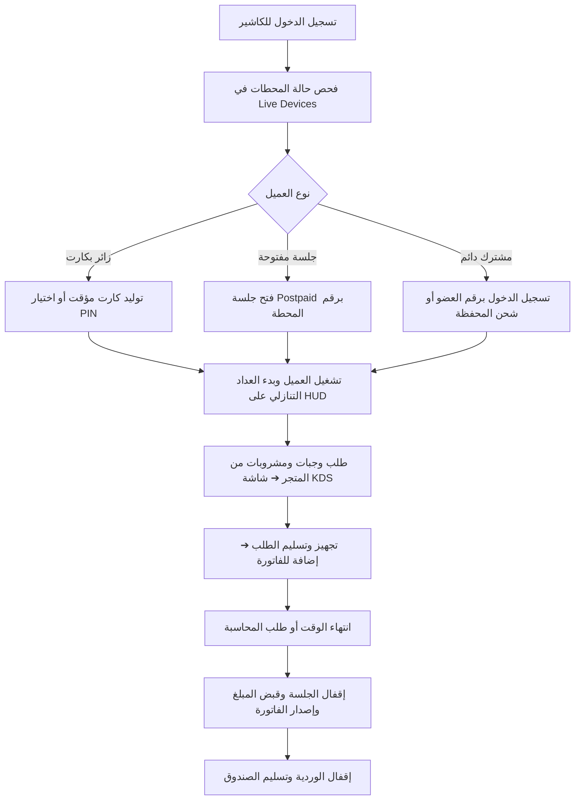

# دليل تشغيل نظام CyberCenter (User & Operations Manual)
## دليل المشغلين والمدراء والكاشير لإدارة صالات الألعاب والإنترنت

---

## 1. نظرة عامة على النظام (System Overview)

نظام **CyberCenter** هو منصة إدارة مركزية متطورة مصممة خصيصاً لمراكز وصالات الألعاب الإلكترونية (eSports Arenas & Gaming Lounges) ومراكز الإنترنت الحديثة. يتميز النظام بمعمارية ثلاثية الطبقات:

1. **الخادم المركزي (Central Backend Server):** مبني بتقنية ASP.NET Core 8 Web API مع Entity Framework Core، ويدير قاعدة بيانات مركزية آمنة مع اتصال حي فوري عبر SignalR، وتدقيق حسابي غير قابل للتعديل (Immutable Audit Trail).
2. **لوحة الإدارة والتحكم (Web Admin Dashboard):** واجهة ويب تفاعلية مبنية بـ React 18 + TypeScript + Tailwind CSS بتصميم **Dark Premium** فخم، تدعم اللغة العربية (RTL) بشكل افتراضي مع إمكانية التبديل إلى الإنجليزية (LTR).
3. **منظومة العميل ومحطات الألعاب (Windows Client Suite):**
   - `CyberCenter.Agent`: خدمة خلفية لنظام ويندوز (`LocalSystem Worker Service`) مسؤولة عن تنفيذ الأوامر الموقعة بـ HMAC-SHA256 ونبض المحطة (Heartbeat).
   - `CyberCenter.Shell`: واجهة تسجيل الدخول والألعاب بـ WPF تمنع الهروب من بيئة اللعب وتعطل اختصارات النظام.
   - `CyberCenter.HUD`: شريط شفاف علوي يعرض العداد التنازلي وسرعة الاتصال واختصار القائمة السريعة (F8) دون أي حقن لذاكرة الألعاب (Anti-Cheat Safe).

---

## 2. جدول صلاحيات الأدوار (RBAC Permission Matrix)

| الوظيفة / الشاشة | المدير العام (Super Admin) | مشرف الوردية (Admin / Cashier) |
| :--- | :---: | :---: |
| **لوحة المؤشرات الحية (Dashboard)** | متاح بالكامل | متاح بالكامل |
| **إدارة ومراقبة الأجهزة الحية (Live Devices)** | فتح / قفل / إعادة تشغيل / إطفاء | فتح / قفل / تمديد الوقت |
| **بدء وإنهاء الجلسات (Sessions)** | متاح بالكامل | متاح بالكامل |
| **إصدار وطباعة وتصدير الكروت (Cards)** | متاح بالكامل | متاح بالكامل |
| **إدارة الأعضاء وشحن المحافظ (Members)** | شحن رصيد / تعديل / إيقاف | شحن رصيد نقدي فقط |
| **المتجر الداخلي وإدارة المنتجات (Store)** | إضافة أصناف وتعديل الأسعار | بيع وتسجيل طلبات فقط |
| **شاشة المطبخ (Kitchen KDS)** | متابعة وتحديث | تجهيز وتسليم الطلبات |
| **سندات الصرف والمصروفات (Expenses)** | متاح بالكامل | تسجيل المصروفات التشغيلية اليومية |
| **التقارير المالية وقائمة الدخل (Reports)** | كشف الأرباح الصافي والتكاليف | إيرادات الوردية الحالية فقط |
| **الإقفال الشهري وتجميد الحسابات (Closing)** | **حصري للمدير العام** | محظور |
| **إدارة حسابات الموظفين (Employees)** | **حصري للمدير العام** | محظور |
| **سجل التدقيق الأمني (Audit Logs)** | **حصري للمدير العام** | محظور |
| **إعدادات النظام والتعرفة (Settings)** | **حصري للمدير العام** | محظور |
| **النسخ الاحتياطي والاستعادة (Backup)** | **حصري للمدير العام** | محظور |

---

## 3. دورة العمل اليومية للكاشير ومشرف الصالة (Daily Operational Workflow)



### خطوة 1: بدء جلسة لزائر بكارت مؤقت (Temporary Card)
1. من القائمة الجانبية، اختر **الكروت المؤقتة**.
2. اضغط على زر **توليد دفعة كروت جديدة** (مثلاً: 20 كرت بفئة 1 ساعة بسعر 500 ر.ي).
3. يمكن طباعة الكروت فورياً على طابعة الإيصالات الحرارية أو تصديرها كملف CSV.
4. يتوجه الزائر إلى المحطة ويكتب رمز الـ PIN المكون من 16 رقماً بتنسيق `XXXX-XXXX-XXXX-XXXX`.
5. فور التحقق، يختفي شاشة القفل وتفتح شاشة ألعاب `CyberCenter.Shell` ويظهر شريط `CyberCenter.HUD`.

### خطوة 2: فتح جلسة مفتوحة (Open / Postpaid Session)
1. من شاشة **الأجهزة الحية (Live Devices)**، اضغط على زر **فتح جلسة** على المحطة المطلوبة.
2. اختر **جلسة مفتوحة (دفع لاحق)**.
3. يبدأ العداد في حساب الوقت تصاعدياً، وتُحسب التكلفة تلقائياً وفق تعرفة الدقيقة المحددة.
4. عند انتهاء اللعب، يضغط الكاشير على **إنهاء الجلسة**، فيظهر إجمالي المبلغ المطلوب والمبيعات المرتبطة بالجلسة، ويتم قبض المبلغ نقدياً أو عبر المحفظة الإلكترونية.

### خطوة 3: إدارة طلبات المشروبات والمأكولات وشاشة المطبخ (Kitchen KDS)
1. عند طلب الزائر أي صنف من قائمة المتجر داخل المحطة، يصل إشعار صوتي ومرئي فوري لشاشة **المطبخ والطلبات (Kitchen KDS)**.
2. تظهر الطلبات في عمود **طلبات جديدة (New Orders)** مرتبة بنظام الوارد أولاً يصرف أولاً (FIFO).
3. يضغط مسؤول البوفيه/المطبخ على **بدء التحضير** لينتقل الطلب إلى عمود **قيد التحضير (Preparing)**.
4. بعد إعداد المشروب أو الوجبة، يضغط على **تم التسليم (Delivered)** ليتم خصم الكمية من المخزون تلقائياً وإضافتها إلى حساب المحطة.

---

## 4. الإقفال المالي والشهري (Financial Closing)

- في نهاية كل يوم، يراجع المشرف شاشة **المصروفات والمدفوعات** لمطابقة الرصيد النقدي الفعلي في الدرج مع مسجل النظام.
- في نهاية كل شهر ميلادي:
  1. يدخل المدير العام (Super Admin) إلى صفحة **الإقفال الشهري**.
  2. يستعرض النظام إجمالي الإيرادات وإجمالي المصروفات وصافي الربح المحقق وعدد الجلسات وساعات اللعب.
  3. يضغط المدير العام على **اعتماد وتجميد الإقفال الشهري**.
  4. يصبح السجل مغلقاً نهائياً ومحمياً برمجياً بصفة `ApprovedAndLocked`، مع منع أي تعديل بأثر رجعي لضمان النزاهة المحاسبية.

---

## 5. سياسات الأمان وإدارة الأزمات (Hardening & Troubleshooting)

### أ. انقطاع الاتصال المؤقت (Offline Grace Period):
- في حال انقطاع كابل الشبكة عن جهاز العميل، تمنح خدمة `CyberCenter.Agent` مهلة سماح افتراضية (5 دقائق قابلة للضبط).
- يستمر اللاعب في اللعب دون مقاطعة، وإذا استمر الانقطاع بعد انتهاء المهلة، تُقفل المحطة تلقائياً لحماية المركز من التسلل أو التهرب.

### ب. شريط HUD ومكافحات الغش (Anti-Cheat Compatibility):
- تم تصميم `CyberCenter.HUD` كنافذة شفافة أعلى سطح مكتب ويندوز دون أي حقن لذاكرة التطبيقات (`No DLL Injection` / `No DirectX Hook`).
- متوافق بنسبة 100% مع أنظمة مكافحة الغش مثل **Riot Vanguard** (لعبة Valorant) و **Easy Anti-Cheat** (Fortnite / Apex Legends) دون أي خطر لحظر حسابات اللاعبين.

### ج. النسخ الاحتياطي واستعادة البيانات المشفرة:
- يتم أخذ نسخ احتياطية دورية آلية في المسار: `C:\CyberCenter\Backups`.
- يحمل كل ملف أرشيف ملف بيان رقمي `.meta.json` يحوي بصمة **SHA-256**.
- لاستعادة النظام بعد أي عطل:
  ```powershell
  # تشغيل موجه PowerShell كمسؤول:
  cd deployment\scripts
  .\Restore-CyberCenterDatabase.ps1 -BackupFilePath "C:\CyberCenter\Backups\cybercenter_backup_YYYYMMDD_HHMMSS.sql"
  ```
- في حال وجود أي تلف أو تلاعب بالملف، يرفض السكريبت الاستعادة فوراً لحماية سلامة بيانات المركز.

