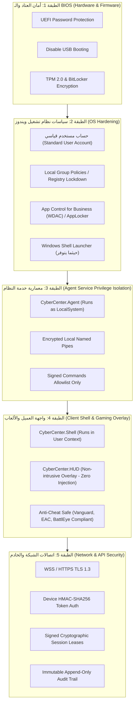

# وثيقة الخطة الأمنية وحماية المحطات (Security & Hardening Plan)
## استراتيجية الدفاع متعدد الطبقات لنظام CyberCenter

---

## 1. فلسفة الأمان (Core Security Philosophy)

تعتمد استراتيجية الأمان في **CyberCenter** على مبدأ **الدفاع متعدد الطبقات (Defense-in-Depth)** ومبدأ **أقل الصلاحيات اللازمة (Principle of Least Privilege)**. 

الهدف الهندسي هو حماية أجهزة المركز من التخريب، العبث بساعة ويندوز لتمديد الوقت مجاناً، سرقة الألعاب والبرمجيات، أو التجسس على خصوصية الزوار، مع **التزام صارم بعدم انتهاك تقنيات مكافحة الغش (Anti-Cheat Systems)** في ألعاب الرياضات الإلكترونية، والاعتراف الصادق بأن الأمان عبارة عن طبقات متراكمة من الضوابط الصلبة وليس مجرد شاشة قفل يمكن إغلاقها من مدير المهام.

---

## 2. مصفوفة الطبقات الأمنية (Multi-Layer Security Matrix)

---

## 3. تفاصيل الطبقات الأمنية وحماية محطات العمل (Workstation Hardening)

### 3.1. عزل الحسابات وصلاحيات التشغيل
- **منع صلاحيات Administrator تماماً:** يسجل الزائر دخوله دائماً بحساب مستخدم قياسي محدود (`CyberGuest` أو حساب العضو).
- **خدمة النظام المستقلة (`CyberCenter.Agent`):** تعمل بصلاحيات `NT AUTHORITY\SYSTEM` كـ Windows Service مستقلة عن أي واجهة تفاعل. هي الوحيدة المسؤولة عن التواصل مع الخادم المركزي، قفل الشاشة، وتنفيذ الأوامر الإدارية.
- **منع الهجمات المتقاطعة (Cross-Process Attacks):** إذا حاول المستخدم إنهاء عملية `CyberCenter.Shell.exe`، ترصد خدمة `CyberCenter.Agent` فوراً توقف الواجهة وتقوم بإعادة تشغيلها فوراً خلال 500 ملي ثانية وقفل الجلسة إذا تكرر الأمر.

### 3.2. سياسات ويندوز الصارمة (Windows Policies & Shell Configuration)
يتم نشر السياسات عبر مجلد `deployment/windows-policies/`:
1. **تعطيل أدوات الاختراق والتحكم للنظام:**
   - تعطيل `Task Manager` (`DisableTaskMgr = 1`).
   - تعطيل سطر الأوامر ومحرر التسجيل (`DisableCMD = 1`, `DisableRegistryTools = 1`).
   - تعطيل مفاتيح التبديل السريع (`Ctrl+Alt+Del` options عبر Group Policy).
   - تعطيل قفل ويندوز الافتراضي (`DisableLockWorkstation = 1`) لمنع حدوث شاشة قفل ويندوز خلف شاشة المركز.
2. **التحكم بالتطبيقات (App Control for Business / WDAC):**
   - حظر تشغيل الملفات التنفيذية من مجلدات التحميل والمجلدات المؤقتة (`%TEMP%`, `Downloads`).
   - السماح فقط للمسارات المعتمدة للألعاب (`C:\Games`, `C:\Program Files (x86)\Steam`, إلخ).
3. **حظر منافذ التخزين الخارجية (USB Storage Blocking):**
   - تعطيل أجهزة التخزين المحمولة (USB Flash Drives) لحماية المحطات من فيروسات الفلاشات، مع إبقاء منافذ لوحة المفاتيح والماوس وسماعات الألعاب تعمل بكفاءة تامة دون تعطيل.

---

## 4. التوافق التام مع أنظمة مكافحة الغش (Anti-Cheat Compliance)

تعتبر هذه النقطة خطاً أحمر في تصميم **CyberCenter**:
- **حظر تام لحقن الـ DLLs (No DLL Injection):** الأنظمة القديمة تقوم بحقن ملفات DLL داخل نوافذ الألعاب لعرض الوقت، مما يؤدي فوراً لحظر حسابات اللاعبين (Bans) بواسطة `Riot Vanguard` (Valorant) أو `Valve Anti-Cheat (VAC)` أو `Easy Anti-Cheat` (Fortnite/Apex Legends).
- **طريقة عمل CyberCenter.HUD:**
  - يعمل كنافذة سطح مكتب مستقلة بتقنية `TopMost Transparent Borderless Window` مع خصائص `WS_EX_TOOLWINDOW` و `WS_EX_NOACTIVATE`.
  - لا يلمس ذاكرة أي لعبة ولا يقرأ أي Handle خاص بعمليات الألعاب.
  - يعمل بسلاسة تامة مع الألعاب المضبوطة على وضع `Borderless Windowed` أو `Windowed Fullscreen`.
  - للألعاب التي تعمل في وضع `Exclusive Fullscreen` القديم، نوفر خيار القائمة السريعة عبر Global Hotkey لا يعيق اللعب.

---

## 5. بروتوكول الأوامر الموقعة (Signed Device Commands & Allowlist)

لمنع أي مهاجم في الشبكة أو موظف غير مصرح له من استغلال الخادم لتشغيل برمجيات خبيثة:
1. **حظر تنفيذ الأوامر العشوائية (No Arbitrary Shell Execution):** لا يوفر الـ API أي Endpoint يتيح إرسال أوامر Cmd/PowerShell نصية إلى الأجهزة.
2. **قائمة بيضاء مسبقة للأوامر (Strict Allowlist):** الأوامر المسموح بها محصورة برمجياً في `enum DeviceCommandType`:
   - `LockStation`
   - `UnlockStation`
   - `RestartComputer`
   - `ShutdownComputer`
   - `DisplayMessage`
   - `RefreshSessionLease`
   - `SyncConfiguration`
3. **التوقيع والتشفير والـ Nonce:**
   - كل أمر يحمل `CommandId` فريد و `Nonce` لمنع هجمات إعادة الإرسال (Replay Attacks).
   - يتم التحقق من توقيع الرسالة بواسطة مفتاح التشفير المشترك بين الجهاز والخادم (`HMAC-SHA256`).

---

## 6. حماية الجلسات والوقت (Session Lease & Anti-Tamper)

- **استحالة التلاعب بالوقت عبر ساعة ويندوز:** ساعة ويندوز المحلية على المحطة ليست سوى وسيلة مساعدة لتقدير الفرق الزمني البسيط؛ العقد الزمني المشفر الصادر من الخادم هو وحده الذي يحدد متى تنتهي الجلسة استناداً لـ UTC الخادم.
- **فترة السماح عند انقطاع الشبكة (Offline Grace Period):**
  - في حال تعطل راوتر المركز، يمنح العميل مهلة زمنية قصيرة قابلة للإعداد (مثلاً 3 دقائق) للاستمرار في اللعب ريثما تعود الشبكة.
  - إذا انتهت المهلة ولم يعد الاتصال بالخادم، تقوم خدمة `CyberCenter.Agent` بقفل الشاشة فوراً وإيقاف الألعاب.

---

## 7. خصوصية ملفات المستخدمين وتنظيف البيانات (Privacy & Cleanup)

- **الزوار المؤقتون (Guests):**
  - يتم تشغيلهم في بيئة معزولة، وعند انتهاء الجلسة، تقوم خدمة `CyberCenter.Agent` بإنهاء العمليات غير الأساسية وحذف الملفات المؤقتة في `%TEMP%` ومسح سجلات التصفح لضمان عدم بقاء أي بيانات حساسة للزائر التالي.
- **الأعضاء الدائمون (Members):**
  - توفير خيار تخصيص مجلد حفظ شخصي مشفر مرتبط بمعرف العضو (حيثما تدعم بيئة المركز ذلك).
- **حظر تخزين أسرار الألعاب:**
  - **يُحظر تماماً** قيام نظام CyberCenter بحفظ أو استخراج كلمات مرور حسابات الزوار الخاصة بمنصات Steam، Epic Games، Discord، أو البريد الإلكتروني في قاعدة بيانات المركز؛ يظل حفظ كلمات المرور شأناً خاصاً بالعميل نفسه داخل تطبيقات الألعاب الرسمية فقط.

---

## 8. معايير أمان الويب والـ API (OWASP ASVS Compliance)

- **المصادقة والتفويض:** JWT Tokens قصيرة الأجل (15 دقيقة) مع Refresh Tokens آمنة ومخزنة في HttpOnly Secure Cookies.
- **تشفير كلمات المرور:** خوارزمية `BCrypt` بعامل تكلفة (Work Factor) متقدم.
- **حماية الإدخال:** فحص شامل بـ `FluentValidation` لمنع هجمات SQL Injection و XSS.
- **الحد من معدل الطلبات (Rate Limiting):** فرض حدود صارمة على محاولات تسجيل الدخول والتحقق من كروت الـ PIN لمنع هجمات القوة الغاشمة (Brute Force).
- **أمان سجل التدقيق:** جدول الـ `audit_logs` محمي بصلاحيات `INSERT ONLY` على مستوى المستخدم التقني للخادم، مما يمنع حتى مسؤولي قاعدة البيانات من التلاعب بسجلات العمليات دون ترك أثر في سجلات النظام.

