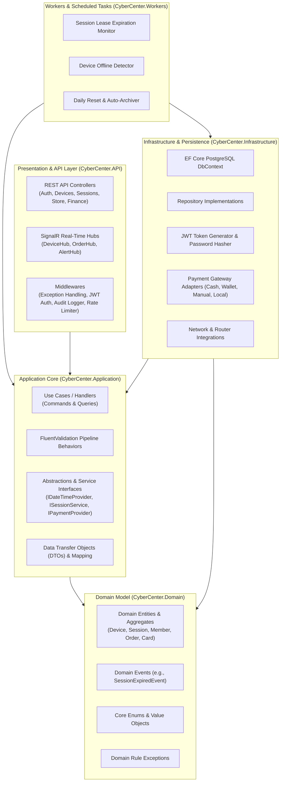
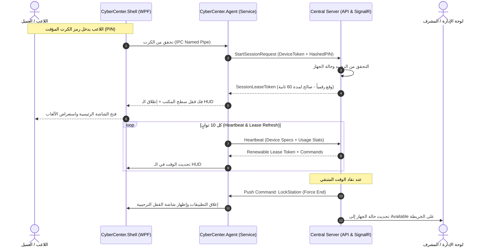
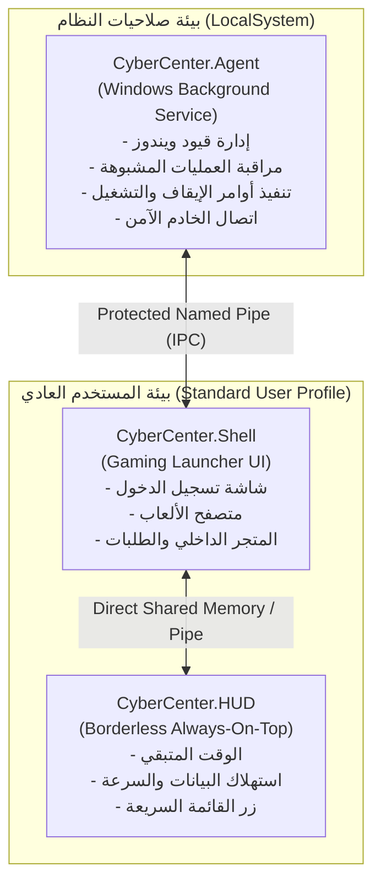
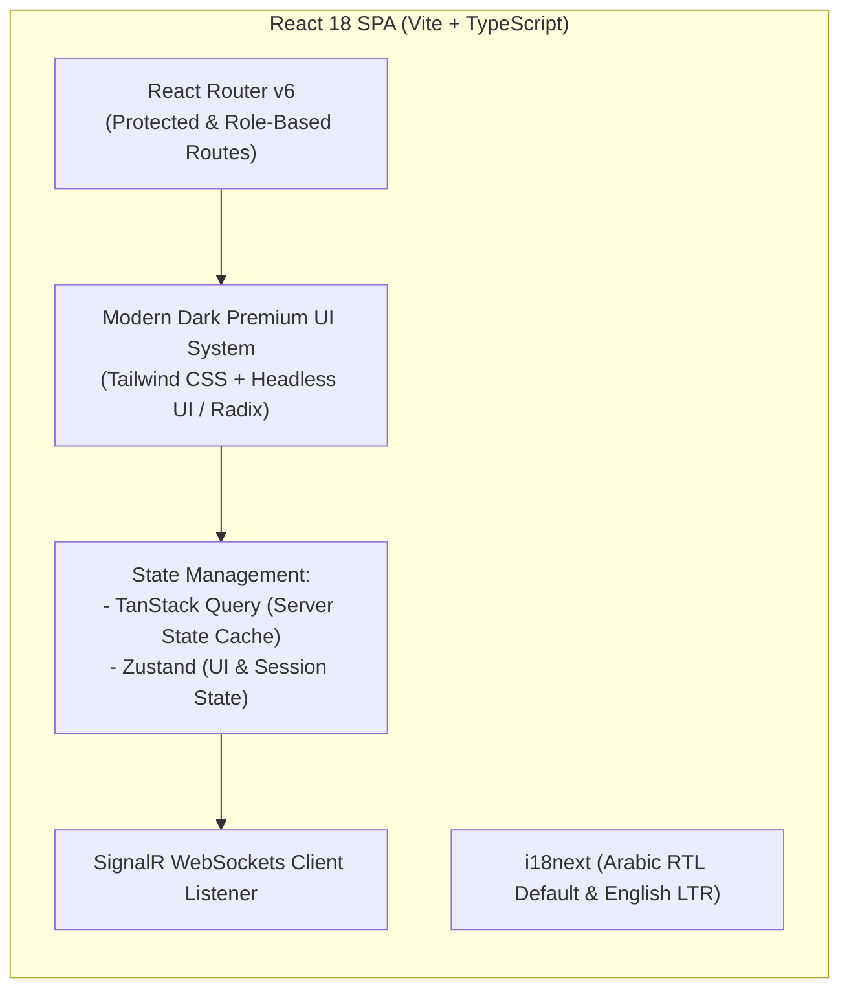

# وثيقة معمارية النظام (System Architecture Document)
## معمارية نظام CyberCenter والاتصالات اللحظية

---

## 1. النمط المعماري العام (Overall Architectural Pattern)

يعتمد خادم **CyberCenter** نمط **المونويلث المعياري (Modular Monolith)** المبني وفق مبادئ **المعمارية النظيفة (Clean Architecture)** ومفاهيم **Domain-Driven Design (DDD)** داخل الوحدات الوظيفية.

### دوافع الاختيار:
- **تجنب تعقيدات الـ Microservices المبكرة:** مراكز الألعاب والإنترنت تعمل عادة ضمن بيئة شبكة محلية (LAN) أو خادم سحابي/محلي موحد، ولا تتطلب فصل الشبكات أو الحاويات الموزعة المعقدة التي تضيف تأخيراً شبكياً ونقاط فشل إضافية.
- **تماسك البيانات وقوة المعاملات:** القدرة على تنفيذ Database Transactions متماسكة للعمليات المالية المعقدة (مثل شحن الرصيد + إصدار الفاتورة + تفعيل الجلسة) دون الحاجة لـ Distributed Saga Coordinator.
- **سهولة التطوير والاختبار والنشر:** إمكانية تشغيل واختبار النظام بالكامل كحزمة متكاملة، مع الحفاظ على عزل صارم بين الطبقات لتسهيل استخراج أي وحدة إلى Microservice مستقبلاً إذا دعت الحاجة.



---

## 2. بروتوكولات الاتصال والتكامل (Communication Protocols)

النظام يوظف ثلاثة بروتوكولات رئيسية متخصصة:

### 2.1. بروتوكول الويب الإداري (Web Dashboard ⇄ Backend API)
- **HTTPS RESTful API:** لمعالجة العمليات الحسابية والتقارير والتسجيل، وتطبيق مبادئ REST، وإرجاع استجابات موحدة بصيغة JSON مع معايير RFC 7807 للأخطاء (Problem Details).
- **SignalR WebSockets (WSS):** لتحديثات الشاشات الحية (تغير حالة الأجهزة فجأة، وصول طلب جديد في شاشة المطبخ، إشعار طلب مساعدة من عميل).

### 2.2. بروتوكول جهاز العميل (Client Agent ⇄ Central Server)
- **SignalR Device Channel:** قناة اتصال مشفرة دائمة بـ WebSockets تضمن إرسال النبض (Heartbeat) وتلقي الأوامر الفورية (Remote Commands) بأقل استهلاك للباندويث وزمن استجابة أقل من 50 ملي ثانية.
- **REST Fallback:** في حال انقطاع قناة الـ WebSockets، يعود الـ Agent تلقائياً للتحقق الدوري عبر REST Endpoints مشفرة برمز مصادقة الجهاز (`X-Device-Token`).

### 2.3. بروتوكول الاتصال المحلي بين مكونات العميل (Agent ⇄ Shell ⇄ HUD)
- **Windows Named Pipes المشفرة محلياً:** قناة اتصال فائقة السرعة على نفس الجهاز بين خدمة النظام (`CyberCenter.Agent`) وواجهة المستخدم الرسومية (`CyberCenter.Shell`) وشريط التراكب (`CyberCenter.HUD`).
- **صلاحيات الأمان:** يتم ضبط أمان القناة بحيث ترفض أي اتصال من عمليات لا تملك التوقيع الرقمي للمركز أو تعمل خارج الجلسة النشطة.



---

## 3. خوارزمية عقود الإيجار الزمنية (Cryptographic Session Lease Protocol)

لمنع اللاعبين من العبث بساعة ويندوز المحلية لتمديد الوقت مجاناً، ولمنع استغلال انقطاع الشبكة:

1. **الخادم هو مصدر الوقت (NTP Source of Truth):** الخادم يولد ختم زمني موحد (UTC Timestamp).
2. **رمز الإيجار المشفر (Signed Lease Token):** يحتوي على:
   ```json
   {
     "sessionId": "4b68e9e1-2c90-410a-bdf3-8cfcf65de5f8",
     "deviceId": "station-07",
     "leaseExpiresAtUtc": "2026-11-01T11:45:00Z",
     "remainingTotalSeconds": 2400,
     "signature": "HMAC-SHA256(deviceId + leaseExpiresAtUtc, ServerSecret)"
   }
   ```
3. **فترة الصمود عند انقطاع الاتصال (Offline Grace Period):**
   - في حال تعذر وصول نبض الجهاز للخادم (انقطاع سلك الشبكة أو الراوتر)، يقوم الـ Agent باحتساب الوقت المتبقي من آخر عقد إيجار صالح فقط، ولا يسمح باللعب أكثر من مهلة محددة مسبقاً (مثلاً 5 دقائق Grace Period).
   - بعد انتهاء المهلة، يقفل الجهاز المحطة فوراً حفظاً لإيرادات المركز وتفادياً للعب غير المصرح به.
   - عند عودة الشبكة، يرسل الـ Agent تقرير مصالحة (Reconciliation Payload) بالوقت الفعلي المنقضي لتسويته مع قاعدة البيانات.

---

## 4. تصميم معمارية أجهزة العملاء (Client Station Subsystems)

تم عزل مكونات العميل على مستويين من الصلاحيات:



### 4.1. `CyberCenter.Agent` (Windows Service)
- يعمل كخدمة نظام مستقلة تماماً تبدأ تلقائياً مع إقلاع الجهاز وقبل تسجيل دخول المستخدم.
- يملك صلاحيات تعديل سياسات ويندوز، إدارة تشغيل شاشة القفل، وإجراءات إعادة التشغيل وتنظيف الملفات المؤقتة.
- لا يتضمن أي واجهة رسومية مباشرة لمنع هجمات كسر الواجهات (Shatter Attacks).

### 4.2. `CyberCenter.Shell` (Gaming UI)
- تطبيق WPF عصري يعمل تحت حساب المستخدم العادي المحدود (Standard User).
- يستقبل الأوامر من الـ Agent ويعرض الواجهات للمستخدم النهائي.
- يمنع تشغيل أكثر من نسخة على نفس المحطة ويضمن إخفاء نفسه أو ظهوره استناداً لأوامر الـ Agent.

### 4.3. `CyberCenter.HUD` (Gaming Overlay)
- نافذة شفافة (Click-Through or Borderless Floating Widget) مبرمجة بطريقة `WS_EX_TOPMOST` و `WS_EX_TRANSPARENT` دون استخدام أي تقنيات حقن ذاكرة أو DLL Hooking لضمان التوافق الكامل 100% مع ألعاب البطولات مثل Valorant و Counter-Strike 2 و League of Legends.

---

## 5. هيكلية معمارية لوحة الإدارة (Web Dashboard Architecture)

لوحة الإدارة مبنية بأسلوب **Single Page Application (SPA)** حديث ومحكم:



- **تزامن الكاش اللحظي (Optimistic Updates & Invalidation):** عند استقبال حدث SignalR بتغير حالة جهاز، يقوم `TanStack Query` بتحديث الـ Cache فوراً لإعادة رسم البطاقة دون الحاجة لإعادة تحميل الصفحة.
- **التدويل التام (i18n):** دعم محكم لتغيير اتجاه الصفحة بالكامل من راست اليمين (RTL) لليسار (LTR) مع قلب الهوامش والأيقونات ديناميكياً ودون كسر التخطيط.
