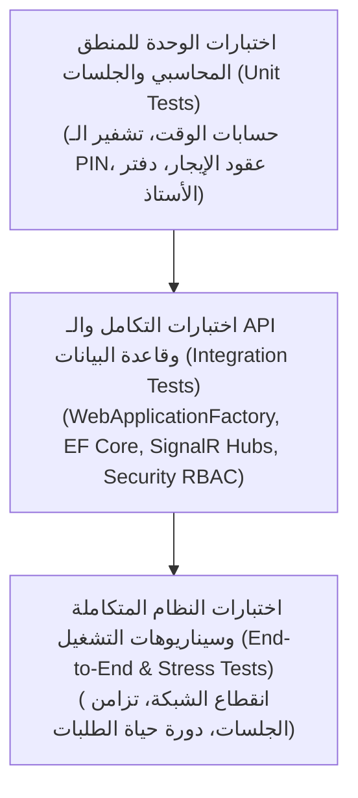

# وثيقة استراتيجية الاختبار وضمان الجودة (Testing Strategy Document)
## خطة التحقق والاختبار الشامل لنظام CyberCenter

---

## 1. هرم ومبادئ الاختبار (Testing Pyramid & Core Philosophy)

تعتمد استراتيجية الجودة في **CyberCenter** على مبدأ **الجودة المدمجة (Built-in Quality)**؛ بحيث لا يتم اعتبار أي ميزة مكتملة أو دمج أي مرحلة برمجية دون وجود تغطية اختبار آلية تثبت صحة السلوك البرمجي ومنع الانتكاسات (Regressions).

---

## 2. مستويات الاختبار ومسؤولياتها (Testing Levels)

### 2.1. اختبارات الوحدة (Unit Tests - `CyberCenter.UnitTests`)
تختبر منطق الأعمال المعزول في طبقتي الـ `Domain` والـ `Application` دون الاعتماد على شبكة أو قاعدة بيانات خارجية:
- **محرك الجلسات والوقت:**
  - اختبار دقة احتساب الثواني المتبقية للجلسات المفتوحة والمحددة.
  - التحقق من تمديد الجلسات وتحديث التكلفة المالية المتراكمة.
- **توليد وتشفير الكروت المؤقتة:**
  - التحقق من عشوائية الـ PIN (16 رقماً) واستحالة تكراره.
  - التحقق من تشفير الـ PIN والتحقق من صحته عبر Hash Verifier.
  - التأكد من قناع الكرت (`Masked Code`) وعدم تسريب الـ PIN بالكامل.
- **التوقيع الرقمي لعقود الإيجار (Session Lease Signatures):**
  - توليد التوقيع الرقمي للـ Lease والتحقق من رفض أي تعديل غير مصرح به في مدة الصلاحية أو معرف الجهاز.
- **القيود المالية ودفتر الأستاذ:**
  - التحقق من توازن القيود المحاسبية، وتطبيق قاعدة `DECIMAL(18,2)` بدقة دون كسور تقريبية، والتحقق من قواعد قيود العكس (Reversal Invariants).

### 2.2. اختبارات التكامل (Integration Tests - `CyberCenter.IntegrationTests`)
تختبر تفاعل مكونات النظام عبر `Microsoft.AspNetCore.Mvc.Testing.WebApplicationFactory`:
- **المصادقة والصلاحيات (Auth & RBAC Matrix):**
  - اختبار حجب مسارات الـ Super Admin عن المستخدمين العاديين والمشرفين التشغيليين.
  - التحقق من تجديد الـ JWT Tokens والتعامل مع الرموز منتهية الصلاحية.
- **قواعد البيانات والمعاملات (Database Transactions & Atomicity):**
  - اختبار التراجع (Rollback) التلقائي في حال فشل أي جزء من عملية دفع أو طلب متجر لضمان عدم حدوث تضارب في الأرصدة.
- **اتصالات SignalR اللحظية:**
  - اختبار بث أحداث تغير حالة الأجهزة واستقبالها بنجاح عبر قناة الـ Hub.
  - اختبار تزامن شاشة المطبخ KDS مع طلبات الزوار الجديدة.

### 2.3. اختبارات العميل والاتصال المحلي (Client & IPC Tests - `CyberCenter.ClientTests`)
- اختبار آلة حالة الـ Agent (`DeviceAgentStateMachine`): الانتقال الصحيح بين حالات (`Locked`, `SessionActive`, `GracePeriod`, `Offline`).
- اختبار أمان قنوات الـ Named Pipes المحلية ورفض اتصالات العمليات المجهولة.

---

## 3. اختبارات الأمان والصلابة ومحاكاة الاختراق (Resilience & Pen-Testing)

| سيناريو الفحص (Test Scenario) | الإجراء المتخذ | النتيجة المتوقعة للنجاح |
| :--- | :--- | :--- |
| **محاولة العبث بساعة ويندوز المحلية** | تغيير تاريخ ووقت الحاسوب العميل يدوياً أثناء جلسة نشطة | استمرار احتساب الوقت استناداً لعقد إيجار الخادم المركزي وعدم تمديد وقت اللعب ثانية واحدة. |
| **محاولة تخمين رموز الـ PIN للكروت** | إرسال 20 محاولة تحقق غير صحيحة متتالية في أقل من دقيقة | تفعيل الحظر المؤقت (Rate Limiter) وتجميد المحطة وتسجيل المحاولة في الـ Audit Log. |
| **انقطاع شبكة المركز فجأة** | فصل كابل الشبكة أثناء جلسة نشطة | دخول العميل في فترة السماح (Grace Period) والعد التنازلي التلقائي ثم قفل المحطة عند انتهاء المهلة دون تسريب دقائق مجانية. |
| **محاولة إنهاء واجهة العميل قسرياً** | محاولة إغلاق `CyberCenter.Shell.exe` بأمر `taskkill` | رصد خدمة `CyberCenter.Agent` للتوقف الفجائي وإعادة تشغيل الواجهة فوراً وقفل الشاشة. |
| **محاولة تعديل قيد مالي معتمد** | إرسال طلب API لتعديل أو حذف قيد محاسبي بعد إقفال الشهر | رفض الخادم للطلب فوراً برمز `403 Forbidden` وتسجيل محاولة الاختراق. |

---

## 4. اختبارات تجربة المستخدم واللغات (UI & i18n Verification)

- **فحص التدويل اللغوي (RTL / LTR Completeness):**
  - فحص شاشات لوحة الإدارة الـ 26 للتحقق من عدم وجود أي كلمة ثابتة غير مترجمة.
  - التحقق من صحة انقلاب القوائم والجداول ومحاذاة النصوص عند التبديل بين العربية والإنجليزية.
- **فحص استجابة الشاشات (Responsive & Resolution Testing):**
  - التحقق من تناسق لوحة الإدارة على شاشات الحواسيب المكتبية والشاشات العريضة والأجهزة اللوحية للكاشير.
  - التحقق من ملاءمة واجهة ألعاب العميل على دقات العرض القياسية (`1920x1080`, `2560x1440`, `4K`).

---

## 5. شروط بوابة القبول لكل مرحلة (Phase Quality Gates)

لا يتم اعتماد أي مرحلة برمجية أو رفع Commit إلى المستودع إلا باستيفاء الشروط التالية:
1. اكتمال عملية التجميع والبناء (`dotnet build` / `npm run build`) بصفر أخطاء وصفر تحذيرات حرجة.
2. اجتياز كافة اختبارات الوحدة والتكامل الخاصة بالمرحلة بنسبة نجاح 100%.
3. خلو الكود من أي بيانات سرية أو مفاتيح تشفير أو كلمات مرور ثابتة.
4. عدم الاعتماد على بيانات وهمية (Mock Data) في الوظائف المرتبطة بقاعدة البيانات.
