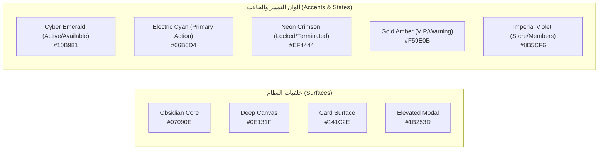

# وثيقة معايير التصميم وتجربة المستخدم (UI/UX Guidelines)
## الهوية البصرية ونظام التصميم Dark Premium لنظام CyberCenter

---

## 1. الفلسفة البصرية (Visual Identity & Design Philosophy)

تم تصميم واجهات **CyberCenter** لتعكس هوية **Dark Premium** فخمة، تجمع بين طابع صالات ألعاب الـ eSports الاحترافية ومراكز القيادة التكنولوجية المتقدمة (Command & Control Centers).  
نبتعد تماماً عن التصاميم التقليدية الباهتة أو الواجهات الإدارية الرمادية القديمة، لصالح تجربة بصرية سينمائية عميقة ومريحة للعين في البيئات ذات الإضاءة الخافتة (Low-Light Gaming Environments)، مع الحفاظ على وضوح البيانات وسرعة الوصول للوظائف التشغيلية.

---

## 2. لوحة الألوان المعتمدة (Design Color Tokens)

### 2.1. درجات الألوان الأساسية:
- **Surface - Dark Obsidian (`#07090E`):** الخلفية الكلية الأساسية للشاشة.
- **Surface - Deep Canvas (`#0E131F`):** خلفية مساحة العمل والجداول.
- **Surface - Card / Panel (`#141C2E`):** بطاقات الأجهزة والـ Widgets الإحصائية.
- **Surface - Elevated (`#1B253D`):** النوافذ المنبثقة (Modals) والقوائم المنسدلة (Dropdowns).
- **Borders & Dividers (`#253350`):** حدود خفيفة وأنيقة بدقة 1px تفصل العناصر وتمنحها عمقاً مدروساً.

### 2.2. ألوان الحالات والمؤشرات (Semantic Status Colors):
- **متاح (Available):** أخضر نيون زمردي (`#10B981`) مع وهج خافت (Soft Glow).
- **مشغول (Occupied):** أزرق سايبر متقد (`#06B6D4`).
- **محجوز (Reserved):** بنفسجي ملكي (`#8B5CF6`).
- **مقفل / خطر (Locked / Error):** أحمر قرمزي صارم (`#EF4444`).
- **صيانة / غير متصل (Maintenance / Offline):** رمادي رصاصي داكن (`#475569`).
- **عضوية مميزة / تحذير (VIP / Warning):** ذهبي عنبري فاخر (`#F59E0B`).

---

## 3. الطباعة والخطوط (Typography System)

- **اللغة العربية (افتراضياً):** خط **Cairo** أو **IBM Plex Sans Arabic** - يتميز بوضوح الأرقام العربية واللاتينية، ومقروئية فائقة في الشاشات العريضة.
- **اللغة الإنجليزية:** خط **Inter** أو **Plus Jakarta Sans** - أسلوب حديث وهندسي متناسق.
- **أوزان الخطوط المعتمدة:**
  - `Regular (400)` للنصوص والفقرات وسجلات البيانات.
  - `Medium (500)` لعناوين الجداول وأزرار التفاعل.
  - `SemiBold (600)` لبطاقات الإحصائيات وعناوين الأقسام.
  - `Bold (700)` لأرقام الأجهزة الكبيرة والأسعار والمؤشرات الحيوية.

---

## 4. معايير دعم اللغات والاتجاهات (RTL / LTR Bidirectional Rules)

- **العربية (RTL):** هي اللغة الافتراضية للنظام بكافة شاشاته.
- **محاذاة العناصر:**
  - ينقلب الـ Sidebar ديناميكياً من اليمين (في RTL) إلى اليسار (في LTR).
  - أسهم التنقل وأيقونات الاسترجاع والتقدم تنعكس تلقائياً.
  - استخدام فئات الـ CSS المنطقية (Logical Properties) مثل `ms-` (margin-inline-start) و `pe-` (padding-inline-end) لضمان عدم حدوث تشوه بصري عند التبديل.
- **حظر النصوص الثابتة (Zero Hardcoded Text):** جميع النصوص والرسائل، بما فيها نصوص التحقق وأخطاء الخادم، تمر عبر ملفات قواميس الترجمة الموحدة (`ar.json`, `en.json`).

---

## 5. هيكلية مكونات لوحة الإدارة (Admin Dashboard Anatomy)

### 5.1. الشريط الجانبي (Modern Sidebar):
- شعار المركز بنبض إضاءة خفيف (Cyber Glow).
- أقسام مجمعة منطقياً:
  - **الرئيسية:** لوحة المؤشرات (Dashboard).
  - **المحطات والتحكم:** الأجهزة الحية (Live Devices)، الجلسات النشطة (Sessions).
  - **المستخدمين والاشتراكات:** الأعضاء (Members)، الكروت المؤقتة (Temporary Cards)، طباعة الكروت (Card Printing).
  - **المبيعات ونقاط البيع:** المتجر والمنتجات (Store)، شاشة المطبخ (Kitchen KDS).
  - **المالية والمحاسبة:** المدفوعات (Payments)، المصروفات (Expenses)، التقارير (Reports)، الإقفال الشهري (Monthly Closing).
  - **الشبكة والنظام:** مراقبة الشبكة (Network)، مراقبة الطاقة (Energy)، الموظفين والصلاحيات (Employees & Roles)، سجل التدقيق (Audit Logs)، إعدادات النظام (Settings).

### 5.2. الشريط العلوي (Topbar):
- بحث عالمي سريع (Global Search) للبحث الفوري عن رقم جهاز، اسم عضو، أو رقم طلب.
- مؤشر حالة اتصال السيرفر اللحظي (SignalR Live Status Pill).
- جرس الإشعارات الفورية مع عداد التنبيهات غير المقروءة.
- زر تبديل اللغة الفوري (AR ⇄ EN).
- بطاقة المستخدم مع صورته الشخصية ودوره الإداري وقائمة تسجيل الخروج.

### 5.3. بطاقة الجهاز التفاعلية (Station Live Card):
- رأس البطاقة: رقم الجهاز بخط عريض، مع مؤشر الحالة المضيء (Pill Badge).
- وسط البطاقة: اسم المستخدم الحالي، العداد التنازلي للوقت المتبقي، وشريط تقدم زمني مرئي (Progress Bar).
- أسفل البطاقة: سرعة التحميل والرفع الحالية (Download/Upload Mbps)، واستهلاك الجلسة.
- شريط إجراءات سريعة عند التحويم (Hover Quick Actions): فتح/قفل، تمديد 30 دقيقة، إرسال رسالة، تفاصيل كاملة.

---

## 6. واجهة عميل الألعاب وشريط التراكب (Client Gaming UI & HUD)

### 6.1. شاشة العميل الترحيبية وشاشة القفل (Shell Lock Screen):
- خلفية ديناميكية داكنة بأمواج ضوئية سلسة لا تستهلك موارد كرت الشاشة.
- خياران رئيسيان واضحان:
  - **تسجيل دخول سريع بالكارت المؤقت:** إدخال رمز الـ PIN المكون من 16 رقماً مع لوحة مفاتيح رقمية افتراضية واضحة.
  - **تسجيل دخول الأعضاء:** اسم المستخدم وكلمة المرور مع إمكانية استعادة الحساب.
- زاوية تعرض رقم الجهاز، ساعة الخادم الدقيقة، وحالة اتصال المحطة.

### 6.2. شريط التراكب الشفاف (HUD & Quick Menu):
- **CyberCenter.HUD:**
  - يثبت في الزاوية العلوية اليمنى أو المركزية العليا بحجم مدمج لا يحجب عناصر اللعبة (Radar / Crosshair / Health bar).
  - يعرض: الوقت المتبقي بالأرقام الكبيرة، سرعة الباندويث اللحظية، ومؤشر الاتصال.
  - زر أنيق لفتح "القائمة السريعة" أو اختصار لوحة المفاتيح المخصص (`F8` أو `Ctrl+Shift+C`).
- **القائمة السريعة (Quick Menu Modal):**
  - نافذة ألعاب فاخرة تنبثق فوق اللعبة دون قطعها:
    1. متصفح الألعاب والمنصات (Steam, Epic, Riot, EA, Battle.net).
    2. متجر المأكولات والمشروبات لطلب وجبة دون مغادرة الكرسي.
    3. طلب المساعدة الفورية (Support Ticket) لإشعار موظفي الصالة بحضورك.
    4. استعراض استهلاك البيانات ورصيد العضوية.
    5. إنهاء الجلسة الآمن.

